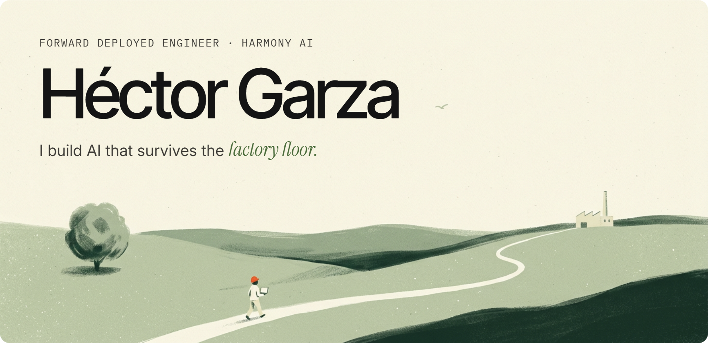

I'm the first Forward Deployed Engineer (FDE) in Mexico for **Harmony AI**, building our presence here from the ground up, on-site with the people running the line.

I love owning things end to end and using AI to make real processes better, shipping work that holds up on day one, not just in a demo. Based in Torreón, MX.

NOW

→ Deploying AI on manufacturing floors with Harmony  
→ Building `osify`, my own Spotify client  
→ Writing notes at [osifraga.dev](https://osifraga.dev)

---

[osifraga.dev ↗](https://osifraga.dev) &nbsp; [LinkedIn ↗](https://www.linkedin.com/in/osifraga/)